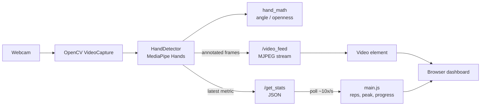

# RehabApp

### Real-time hand-tracking biofeedback for physical-therapy exercises

RehabApp is a computer-vision web app that turns a standard webcam into a
real-time biofeedback tool for hand and finger rehabilitation exercises. It uses
**MediaPipe Hands** for landmark detection and **Flask** to serve an annotated
live video stream alongside a lightweight metrics dashboard, giving patients and
therapists immediate visual feedback on finger flexion and hand open/close
range of motion.

> Note: This is an engineering/portfolio project for movement biofeedback. It is
> not a medical device and makes no clinical or diagnostic claims.

## Overview

A single hand is tracked through the webcam. For each frame the backend computes
one of two exercise metrics from MediaPipe's 21 hand landmarks and streams the
annotated frame (with the hand skeleton drawn on it) to the browser. The
frontend polls a JSON endpoint to drive a live value readout, a progress bar
toward a goal, a per-session peak value, and a repetition counter.

## Key features

- **Two exercises**
  - **Index-finger flexion** — interior joint angle of the index finger
    (landmarks 5-6-7), reported in degrees.
  - **Hand open/close** — openness percentage derived from the thumb-tip to
    pinky-tip distance (landmarks 4 and 20), mapped to 0-100%.
- **Live annotated video** — MJPEG stream with the hand skeleton overlaid.
- **Session tracking (client-side)** — peak value and a repetition count per
  session, with a manual "Reset Session" control.
- **Repetition counting via hysteresis** — two thresholds (enter/exit) prevent
  double-counting from hand jitter.
- **State smoothing** — the detector reuses the last valid reading when no hand
  is visible, avoiding the value flickering to zero.
- **Modular static assets** — separate CSS/JS for clean caching and maintenance.

## Tech stack

| Layer    | Technology                                            |
| -------- | ----------------------------------------------------- |
| Backend  | Python, Flask                                         |
| Vision   | MediaPipe Hands (21 landmarks), OpenCV, NumPy         |
| Frontend | Vanilla JavaScript (ES6+), HTML, CSS Grid/Flexbox     |
| Serving  | Flask dev server (Gunicorn listed for deployment)     |

Pinned versions are in [`requirements.txt`](requirements.txt).

## Architecture



- **`app.py`** — Flask app and routes: `/` (dashboard), `/video_feed` (MJPEG
  stream parameterized by `?exercise=`), `/get_stats` (latest metric as JSON).
  Owns the camera and a graceful SIGINT shutdown handler.
- **`services/hand_detector.py`** — `HandDetector` wraps MediaPipe, draws
  landmarks, and keeps the last valid reading between frames.
- **`services/hand_math.py`** — pure landmark maths (interior angle, distance,
  flexion and open/close readings). No camera or MediaPipe imports, so it is
  unit-tested with synthetic landmarks.
- **`templates/index.html`** — dashboard layout (exercise buttons, video
  viewport, data cards).
- **`static/js/main.js`** — polls `/get_stats`, updates the UI, and runs the
  rep-counting and progress-bar logic.
- **`static/css/style.css`** — dashboard styling.

## Getting started

### Prerequisites

- A working webcam.
- Python 3.10+ (the project's `.python-version` targets 3.11).
- macOS, Windows, or Linux. On macOS, grant the terminal/browser camera access.

### Installation

```bash
git clone https://github.com/rehmanazeem915/rehabilitation-app.git
cd rehabilitation-app

python -m venv venv
source venv/bin/activate        # Windows: venv\Scripts\activate

pip install -r requirements.txt
```

### Run

```bash
python app.py
```

Then open `http://127.0.0.1:8000` in your browser. (The app binds to
`0.0.0.0:8000`.)

## Tests

The landmark maths is covered by `pytest` (no camera or MediaPipe needed):

```bash
pip install pytest
python -m pytest
```

## Usage

For a therapist or patient:

1. Open the dashboard and allow camera access. Position the hand so it is fully
   in frame.
2. Pick an exercise in the sidebar — **Index Finger Flexion** or
   **Hand Open/Close**.
3. Perform the movement while watching the live feedback:
   - The **Current** card shows the live angle (degrees) or openness (%).
   - The **Progress to Goal** bar fills as the target motion is achieved
     (for flexion it fills as the finger bends; it turns green past the goal
     threshold).
   - **Session Summary** shows the peak value reached and the rep count.
4. Use **Reset Session** to clear the peak and rep count and start a new set.
   Switching exercises also resets the session.

Rep-counting thresholds (client-side, in `main.js`):

- **Flexion** — a rep counts after the angle exceeds 120 deg (contracted) and
  then returns below 40 deg (extended).
- **Open/Close** — a rep counts after openness drops below 65% (closed) and then
  returns above 85% (open).

## Limitations / next steps

- **Single hand only** — `max_num_hands=1`; only the index finger and a
  thumb-to-pinky span are measured today.
- **Client-side, non-persistent session data** — peak and rep counts live in the
  browser and reset on refresh or exercise change; there is no database or
  per-patient history.
- **2D landmark math** — distances/angles use 2D image coordinates, so readings
  are sensitive to hand orientation and distance from the camera; they are not
  calibrated to anatomical goniometry.
- **Single shared camera/state** — one global `latest_stats` and one camera make
  the app single-user; it is not built for concurrent sessions.
- **Dev server, `debug=True`** — intended for local use, not production
  deployment as-is.
- **Possible next steps** — add more exercises/joints, multi-hand support,
  persistent per-patient progress storage, exportable session reports, and a
  proper WSGI/production deployment (Gunicorn is already pinned).

## Project structure

```text
├── app.py                     # Flask server & routes
├── services/
│   ├── hand_detector.py       # MediaPipe wrapper & last-valid-state handling
│   └── hand_math.py           # Pure angle / distance / openness maths
├── tests/
│   └── test_hand_math.py      # Synthetic-landmark unit tests
├── static/
│   ├── css/style.css          # Dashboard styles
│   └── js/main.js             # Session logic & polling
├── templates/
│   └── index.html             # UI structure
├── requirements.txt
└── LICENSE                    # MIT
```

## License

Released under the [MIT License](LICENSE) © 2026 Azeem Ur Rehman.
